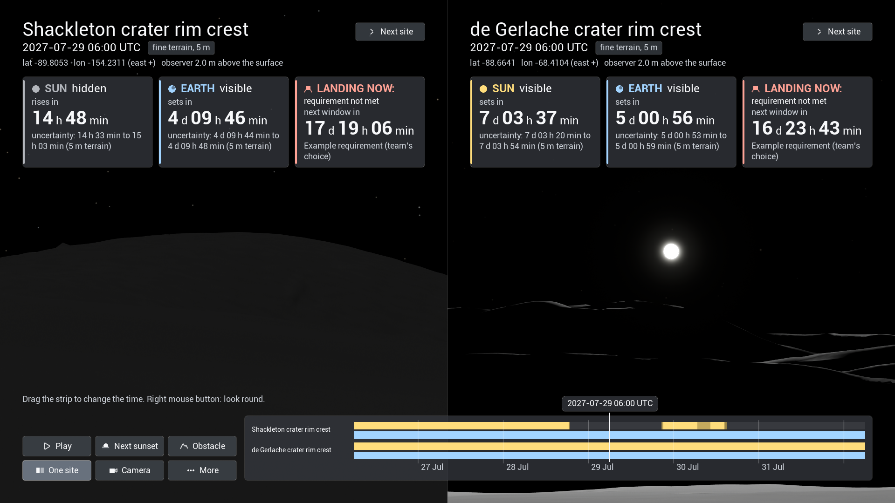

# Lunar Site Navigator

Team **Kestro Aerospace** (Kaan Eşrefoğlu, Barkın Kocatepe) — NASA Space Apps Challenge 2026, Aachen.
Challenge: *Lunar Landing Site Navigator*.

At the lunar south pole the Sun stays within a few degrees of the horizon, so a ridge a few hundred metres away can decide whether a lander has power. Lunar Site Navigator compares landing sites and dates on one screen. For any point on the Moon it computes the 360° terrain horizon from NASA LOLA elevation data and the directions of the Sun and the Earth with NASA SPICE, and reports when each is visible, which terrain blocks it, how many hours that costs, and how far a landing date can slip. At the seven south-polar sites every rise and set time also carries an uncertainty band.

**Try it in the browser:** https://littiary.github.io/lunar-site-navigator/



## What it does

- **Compare** two sites at a chosen time: Sun and Earth visible or hidden, and the time until each rises or sets.
- **Explain** a result: the stretch of terrain that hides the Sun, its distance and direction, and the hours of sunlight it costs.
- **Plan** dates: a 24-month calendar of sunlight and Earth visibility per site, the landing windows that meet a stated requirement, and how many days a planned landing can slip.
- **State the uncertainty**: at the polar sites, and for a new coordinate by default, each rise and set time has a band that follows from a stated two-sigma height error of the terrain model. The 13 sites on the 118 m model have none, because no height error has been measured for that model.
- **Show what to change**: the effect of raising a mast and, at the three project sites, of landing elsewhere inside a 100 m landing circle.
- **Any coordinate**: twenty sites are published, from Apollo 11 to a point in an Artemis III candidate region. A new coordinate is computed in about ten seconds for a 30-day window on a laptop:

```
python -m lsncore custom --lat -85.3 --lon 31.2 --start 2026-11-15T00:00:00Z --out my-site
```


At the Shackleton crater rim, for a sensor 2 m above the ground, a ridge 673 m away costs 373 hours of sunlight in two years: 31 % of everything the site loses to terrain, on NASA's 5 m site model. Moving a few metres changes such numbers, which is why the tool shows them.

## How it works

One science core in Python (`core/`) computes everything and writes versioned result **packages** with checksums (`packages/`, described by the contract in [docs/contract/SPEC.md](docs/contract/SPEC.md)). The web view (`web/`) and the Unreal Engine scene (`unreal/`) only read those packages; neither computes a science result. They look values up and count down to the published times.

- The horizon is traced on the sphere out to 300 km in every direction.
- The Sun is a disc, so a partial sunrise counts as sunlight.
- Terrain: LOLA 5 m site models at two of the three project sites (Shackleton rim and de Gerlache rim; at Malapert the 5 m model failed its seam check against the 20 m product, so the 20 m product is used), the LOLA 20 m and 60 m polar products near the poles, and SLDEM2015 at 118 m per pixel elsewhere (LOLA merged with Kaguya Terrain Camera data).
- Directions of the Sun and the Earth: SPICE with the DE440 ephemeris, light time and stellar aberration included.

Method notes: [docs/method/](docs/method/).

## Why the numbers can be trusted

For every comparison with an outside source, the pass criterion was committed before the comparison was run; the git history shows the order. The validation card ([validation/card/validation_card.md](validation/card/validation_card.md)) has 32 checks: 31 pass and 1 fails, and the failed one stays on the card.

| What is computed | Checked against | Largest difference |
|---|---|---|
| Directions of the Sun and the Earth | JPL Horizons, 95,676 rows | 0.005 arcseconds computed directly; 0.1 arcseconds through the direction table the packages use |
| Sunrise and sunset on a smooth sphere | JPL Horizons rise and set tables | 57 seconds |
| Eclipse of March 2025 at the Blue Ghost site | contact times predicted by Firefly | 0.83 minutes |
| Sun and Earth angles at six Apollo landings | 48 published angles | 0.05° |
| Sunlit and shadowed ground in an LRO image | LROC camera image strip | 89.3 % agreement against a required 90 %: **fails** |

The terrain model has its own acceptance checks ([data/checkpoints/](data/checkpoints/)):

- Height of the global models (SLDEM2015 118 m and LDEM_128 237 m) against the five Apollo and Lunokhod laser retroreflectors: within 7 m. This is the one height check that does not depend on LOLA.
- Height against 148,091 of the LOLA laser returns the 20 m product was built from: within 3.8 m for 95 % of points. This is a lower bound of its error, not an independent test.
- Position against 192 catalogued craters: an offset of 32 m and a rotation of −0.013°.

Checks that failed as written are kept with their cause, in [data/checkpoints/](data/checkpoints/) and [data/notes/](data/notes/).

## Limits

- Outside the polar products the terrain is 118 m per pixel, so relief narrower than about 240 m is not resolved and nearby obstacles of that size cannot be shown.
- All terrain is LOLA or, between 60° S and 60° N, SLDEM2015, which merges LOLA with Kaguya Terrain Camera data. The only independent height check is the five retroreflectors; two LROC images test lit and shadowed ground (one agrees, one fails).
- Event times on real terrain have no independent reference. The validation card lists what is not validated.
- The landing requirement shown in the views is an example chosen by the team, not a mission requirement.
- Known limit of the 118 m product near 90° E, 48° S: [data/notes/known_limit_sldem_step_90e_48s.md](data/notes/known_limit_sldem_step_90e_48s.md).

## Layout

| Folder | Content |
|---|---|
| `core/` | Science core (Python): horizon, ephemeris, event finding. Writes versioned result packages. |
| `data/` | Download and processing scripts for NASA data. No raw data is committed. |
| `validation/` | Comparisons with independent sources and the validation card. |
| `packages/` | The published result packages: 20 sites, a direction table and a site-pairs package. |
| `web/` | Charts, evidence page and viewers. They only read packages. |
| `unreal/` | Unreal Engine scene and planner interface. It only reads packages. |
| `docs/` | Contract, method notes, pictures. |

## Reproducing the results

```
git clone https://github.com/Littiary/lunar-site-navigator.git
cd lunar-site-navigator
python scripts/bootstrap.py --test
```

This creates the Python environment, installs the packages, downloads the SPICE kernels, the default LOLA products (south-polar 20 m and 60 m, and LDEM_16) and the validation inputs to a data folder outside the repository (`LSN_DATA_ROOT`), checks every download against a committed checksum and runs the tests against the committed results. Regenerating the published packages needs further downloads and one more command, described in [packages/README.md](packages/README.md). Options, the same steps as single commands, sizes and limits are in [docs/setup.md](docs/setup.md).

## Data and credits

Every third-party dataset, library and asset is listed with its licence and source in [CREDITS.md](CREDITS.md).

## Use of AI

Parts of the code and documentation in this repository were written with AI coding assistants. The team defines the scope, chooses the data, writes the acceptance thresholds and reviews every change. Details are recorded in [CREDITS.md](CREDITS.md).

## Licence

Apache License 2.0. See [LICENSE](LICENSE).
