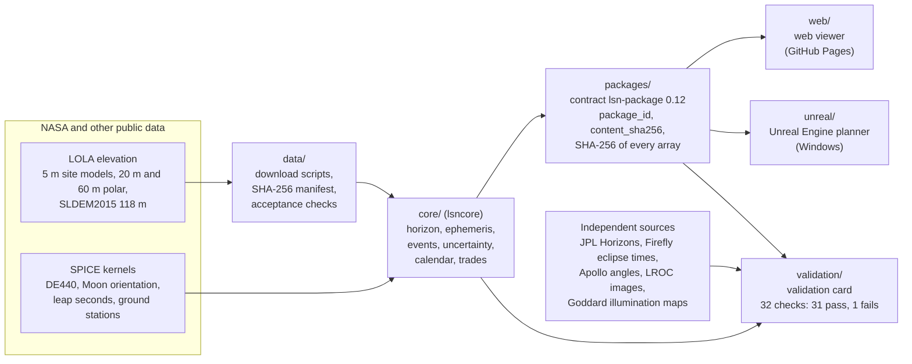

# Architecture

One science core computes every number. It writes them to versioned result packages with checksums. The web viewer and the Unreal Engine planner read those packages and compute no science result of their own. The validation card compares what the core computes with independent sources.

## NASA data

The terrain is the LOLA elevation data of NASA's Lunar Reconnaissance Orbiter: the 5 m site models at two of the three project sites, the 20 m and 60 m polar products near the south pole, and SLDEM2015 (LOLA merged with Kaguya Terrain Camera data, 118 m per pixel) elsewhere. The directions of the Sun and the Earth come from NASA's SPICE system with the DE440 ephemeris and the Moon's orientation kernels; ground-station kernels add the Deep Space Network stations. No raw data is committed. The scripts in `data/` and the kernel fetcher of the core download every file and check it against a SHA-256 recorded in the repository (`data/manifest/manifest.json`, `core/lsncore/ephem/kernel_manifest.json`). The data stream's own acceptance checks (heights against laser retroreflectors and LOLA returns, positions against catalogued craters) are in `data/checkpoints/`. Every source and its licence is in [CREDITS.md](../CREDITS.md).

## Science core

The core (`core/lsncore`, Python) is the one place where results are computed. For a point on the Moon it traces the 360° terrain horizon on the sphere out to 300 km, computes the directions and apparent discs of the Sun and the Earth with light time and stellar aberration, finds every rise and set, and builds the windows, the lunar-day calendar, the cost of each obstacle, the landing windows for example requirements, the mast-height trade and, where a height error is stated, the uncertainty band of every event. The method of each part is described in [docs/method/](method/). A new coordinate can be computed from the command line (`python -m lsncore custom`).

## Packages with SHA-256

The core writes its results as packages in the format of the contract [docs/contract/SPEC.md](contract/SPEC.md), currently `lsn-package` 0.12. A package is a `manifest.json` plus raw binary arrays. Every array reference in the manifest carries the SHA-256 of its file; `content_sha256` is the SHA-256 of the manifest content, so two packages hold the same results exactly when their digests agree; `package_id` is derived from the request and the versions and checksums of the input data, so the same request on the same data gives the same id. Every number carries a method card with its validation status and limits. The published set in [packages/](../packages/README.md) holds 20 site packages, a direction table and a site-pairs package; a test checks that each passes the contract validator, checksums included.

## Web viewer

The web viewer (`web/`) is a static site served on GitHub Pages: https://littiary.github.io/lunar-site-navigator/ . It reads the packages, through `packages/index.json`, and draws the site comparison, countdowns, time strips, calendars, the evidence page and the 3-D views of the Moon and of the ground at a site. Numbers are shown as the package gives them; the viewer formats them (seconds as hours, fractions as percentages) and changes nothing else. It accepts every 0.x package and hides a view whose fields a package lacks. Details: [web/README.md](../web/README.md).

## Unreal planner

The Unreal Engine 5.8.4 planner (`unreal/`) shows a site as a planner would see it: the ground from LOLA data, the Sun and the Earth in their package directions, the ridge that hides the Sun with its cost in hours, two sites side by side at the same instant, the calendar, the uncertainty page and the mast-height trade. It reads the same packages and refuses a package of another major contract version, the wrong package kind, a missing manifest or a truncated array. A stand-alone Windows program is built from it and needs no network connection; the packages are copied into it. Details: [unreal/README.md](../unreal/README.md).

## Validation card

The validation card ([validation/card/validation_card.md](../validation/card/validation_card.md), generated from `validation/card/validation_card.json`) lists 32 checks of the core against independent sources and against exact cases: directions and rise and set times against JPL Horizons, the March 2025 eclipse at the Blue Ghost Mission 1 site against Firefly's predicted contact times, angles at six Apollo landings, long-term illumination against the published LOLA illumination maps of NASA Goddard, and lit and shadowed ground in two LROC images. For every comparison with an outside source the threshold was committed before the comparison was run. 31 checks pass; one fails (the LROC image strip, 89.6 % against a required 90 %) and stays on the card. The eclipse and Apollo comparisons were not blind, and the card says so, together with what is not validated: individual rise and set times on real terrain have no independent reference.
